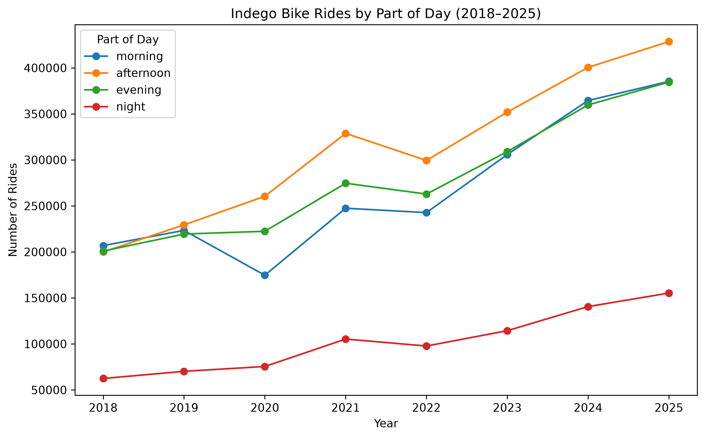

# Philadelphia Indego Bike-Share Ridership Analysis (2018–2025)

## Overview

An exploratory data analysis of Philadelphia's Indego bike-share program, examining **7,728,268 trips from 2018 through 2025**. This project uses Python and Pandas to clean, combine, and analyze historical ridership data alongside Philadelphia weather records.

The analysis investigates station popularity, weekday ridership patterns, precipitation, temperature, and changes in ridership throughout the day.

**Course:** CSC 8000 – Programming for Machine Learning  
**Institution:** Villanova University

## Technologies Used

- Python
- Pandas
- NumPy
- Matplotlib
- Jupyter Notebook

## Project Objectives

1. **Data Processing:** Combine eight years of trip data, standardize timestamps, and identify missing values.
2. **Station Analysis:** Identify the 10 most popular starting and ending stations using average annual ridership and standard deviation.
3. **Weekday Trends:** Compare average daily ridership across the seven days of the week.
4. **Weather Analysis:** Examine how precipitation and temperature relate to ridership.
5. **Time-Series Analysis:** Visualize annual ridership patterns across morning, afternoon, evening, and nighttime periods.

## Key Findings

- **Station Popularity:** 15th & Spruce had the highest average annual starting and ending ridership among matched stations.
- **Weekday Ridership:** Wednesday had the highest average daily ridership, while Sunday had the lowest.
- **Precipitation:** Average daily ridership was approximately 2,942 trips on dry days, 2,270 on rainy days, and 824 on snowy days.
- **Temperature:** The 19.67–24.18°C temperature range recorded the highest number of rides.
- **Time of Day:** Afternoon ridership increased substantially between 2018 and 2025.

## Ridership Visualization

The following chart illustrates annual Indego bike-share ridership from 2018 to 2025, categorized by morning, afternoon, evening, and nighttime trips.

Afternoon rides account for the highest ridership in most years, increasing substantially over the study period. Morning and evening ridership also show overall growth, while nighttime rides remain the least common.

## Dataset

The analysis uses Philadelphia Indego trip records from 2018–2025, station reference data, and historical Philadelphia weather observations.

The datasets were provided through Villanova University's course materials and are not included in this repository.

To reproduce the analysis, obtain the appropriate datasets and update the notebook's file paths as necessary.

## Project Files

- `indego_analysis.ipynb` — Jupyter notebook containing the data processing, analysis, and visualizations.
- `Indego_Analysis_Report.pdf` — Two-page ACM-style report summarizing the methodology and findings.
- `indego_part_of_day.png` — Line chart illustrating annual ridership trends by time of day from 2018 to 2025.

## Limitations

Some trip records could not be matched to station names, and weather records contained missing values. The time-of-day categories also exclude rides between 4:00 AM and 4:59 AM, following the assignment's specified time intervals.
